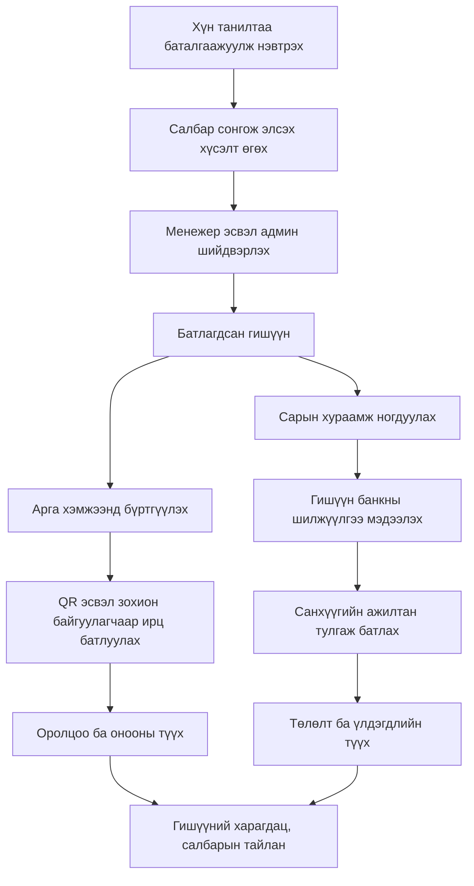

# SDY системийн өнөөгийн бүтэц ба хөгжлийн чиглэл

> Үүний дараах гурван ажлын локал хэрэгжилт, тест, үргэлжлүүлэх цэг:
> [SDY_IMPLEMENTATION_2026-09-15.md](SDY_IMPLEMENTATION_2026-09-15.md).

**SDY-ийн үндсэн зорилго нь холбооны гишүүн, салбар, үйл ажиллагаа, оролцоо,
хураамжийг нэг холбоотой бүртгэлээр удирдах явдал юм.** Хүн өөрийгөө
баталгаажуулж нэвтрэхээс эхлээд салбарт элсэх, арга хэмжээнд оролцох, ирцээ
батлуулах, төлбөрөө бүртгүүлэх хүртэлх зам кодод бий. Дараагийн хөгжлийн
гол үнэлүүр нь эдгээр үйлдлийг бодит гишүүн, ажилтан тогтмол ашиглаж,
байгууллагын ажил хөнгөрч байгаа эсэх байх ёстой.[^1][^2]

Бүтээгдэхүүнийг **ажиллах үндсэн урсгалтай, хязгаарлагдмал туршилтын
ашиглалтын шатанд байгаа систем** гэж үнэлж байна. Нэвтрэлт, байгууллагын
эрх, өгөгдөл тусгаарлалт зэрэг платформын суурь нэлээд хөгжсөн. Харин
гишүүнчлэлийн нарийвчилсан дүрэм, өдөр тутмын мэдэгдэл, төвийн удирдлагын
нэгтгэл, хэрэглэгчдийн тогтмол хэрэглээний нотолгоо цааш гүйцээх ажилтай.
Энэ нь техникийн болон бүтээгдэхүүний нотолгоонд тулгуурласан үнэлгээ;
хөгжүүлэлтийн дууссан хувийг хэмжсэн дүн биш.[^3][^4]

Үнэлгээ нь 2026-09-15-ны локал `90745acc` суурь код, SDY-ийн ажиллагааны
баримтууд, тухайн өдрийн production-ийн унших шалгалтад хамаарна. Одоогийн
тестийн нэмэлтүүд локалд байгаа. Эндхүү ирээдүйн чиглэлүүд нь санал бөгөөд
байгууллагаас баталсан төсөв, хугацаа, дүрэм гэсэн утгагүй.[^3][^5]

**Гишүүнд өгөх үнэ цэн нь өөрийн харьяалал, боломж, оролцоо, төлөлтөө ойлгомжтой
харах явдал.** Гишүүнд «ямар салбартай вэ», «дараагийн ямар арга хэмжээнд
оролцож болох вэ», «миний ирц зөв бүртгэгдсэн үү», «энэ сарын төлөлт ямар
байна» гэсэн асуултад хариу хэрэгтэй. Менежерт хүлээгдэж буй хүсэлт,
арга хэмжээ, ирцээ удирдах орчин; санхүүгийн ажилтанд тулгалт, үлдэгдэл,
залруулгын түүх хэрэгтэй. Аймгийн удирдлагад салбаруудаа ижил тодорхойлолттой
үзүүлэлтээр харах хэрэгцээ үүснэ. Сүүлийн хэрэгцээний SDY-д зориулсан
нэгтгэл одоогоор бүрэн хэрэгжээгүй.[^2][^6]

Одоогийн бизнесийн урсгал дараах холбоотой. Тайлан, хувийн ирц/төлөлтийн
харагдац нь үндсэндээ сонгосон идэвхтэй байгууллагын хүрээнд ажилладаг.

Энэ зураг дахь хураамжийн урсгал кодод байгаа ч production-д хураамжийн
тохиргоо, ногдуулалт хараахан үүсээгүй. Нэвтрэх, элсэх хоёр тусдаа алхам:
eID-ээр танигдсан нь хүсэлт шийдэгдэхээс өмнө салбарын хувийн мэдээллийг
харах эрх олгохгүй.[^2][^3]

**Байгууллагын бүтэц нь Дархан-Уул аймаг болон дөрвөн сумд төвлөрсөн.**
Дархан, Орхон, Шарын гол, Хонгор сум нь аймгийн байгууллагын хүүхэд
байгууллагууд. Аймгийн байгууллага өөрөө бас лавлахад байгаа тул таван
идэвхтэй байгууллага гэсэн тоо гарна. Өмнөх 21 аймгийн сонголтыг өөрчилсөн
түүхтэй; өнөөгийн таван байгууллагын загварыг улсын хэмжээний батлагдсан
бүтэц гэж тайлбарлаж болохгүй.[^1][^2][^3]

Эцэг-хүүхэд холбоос нь бүтэц заадаг. Аймгийн байгууллагад эрхтэй байх нь
хүүхэд байгууллагын гишүүн бүрийн мэдээллийг автоматаар харах эрх болохгүй.
Төвийн хяналт, салбарын ажиллах бие даасан байдлыг ирээдүйд тодорхой эрх,
тайлангийн хүрээгээр холбоно. Платформд байгууллага хооронд тайлан үзүүлэх
зөвшөөрлийн суурь байдаг ч SDY-ийн одоогийн оролцоо, хураамжийн тайлан
салбар тус бүрийн endpoint-оор ажилладаг.[^6][^7]

| Оролцогч | Одоогийн үндсэн боломж | Эрхийн чухал хил |
| --- | --- | --- |
| Нэвтэрсэн боловч элсээгүй хүн | Салбар сонгох, хүсэлт гаргах, төлөв харах | Элсэлт шийдэгдэхээс өмнө салбарын дотоод өгөгдөл нээгдэхгүй |
| Гишүүн | Арга хэмжээ харах, бүртгүүлэх, ирц батлах, өөрийн оноо/хураамж харах | Арга хэмжээ удирдах, бусдын төлөлт батлах эрх анхдагчаар байхгүй |
| Менежер | Элсэх хүсэлт шийдэх, арга хэмжээ болон ирц удирдах | Харьяаллын шилжилт шийдэхгүй; админы эрх, санхүүгийн эрх автоматаар авахгүй |
| Салбарын админ | Салбарын эрх удирдах, очих салбарын шилжилт шийдэх, санхүү | Эрх нь тухайн байгууллагын хүрээнд |
| Санхүү хариуцсан тусгай эрхтэй хүн | Хураамж тохируулах, ногдуулах, төлөлт тулгах, залруулах | `membership.finance`-ийг тусгайлан олгоно; бүхэл admin эрх заавал шаардахгүй |
| Платформын оператор | Суулгац, байгууллагын ажиллагаа, техникийн дэмжлэг, операторын аудит | Байгууллагын админаас тусдаа бүртгэл, session, эрхийн урсгалтай |

Энэ хүснэгт нь анхдагч эрхийн загварыг тайлбарлана. Админ нэмэлт role
үүсгэж эрх олгож чадна. Модулийн `AdminOnly` тэмдэг нь тухайн эрхийг
менежер/гишүүнд автоматаар олгохгүй гэсэн утгатай; админ бус тусгай
санхүүгийн role-д гараар олгох боломжийг хаадаггүй.[^8][^9][^10]

**Харьяалал шилжүүлэх урсгал нь одоогийн системийн сайн хамгаалагдсан хэсгүүдийн
нэг.** Гишүүн эх, очих байгууллага, шалтгаанаа өгнө. Хүсэлт хүлээгдэж
байхад эх гишүүнчлэл хэвээр; очих байгууллагын идэвхтэй админ баталмагц
сонгосон эх гишүүнчлэл дуусаж, шинэ салбарт энгийн гишүүний эрх үүснэ.
Хуучин менежер, админы эрх шинэ салбарт автоматаар сэргэхгүй. Цорын ганц
админ байгууллагаа эзэнгүй үлдээх шилжилтийг хориглоно.[^11]

Нэг хүнд нэг pending шилжилт үлдээх нөхцөл, батлах/цуцлах үеийн түгжээ,
хуучин session хүчингүй болгох үйлдэл, шийдвэрийн аудит бий. Өмнөх ирц,
оноо, хураамжийн мөрүүд эх байгууллагад үлдэнэ. Энэ нь өгөгдөл хадгалж
байгаагийн баталгаа боловч шилжсэн хүн хуучин ба шинэ салбарынхаа түүхийг
нэг дэлгэцээр харж чадна гэсэн үг биш; ийм хувийн нэгтгэл цаашдын ажил.[^2][^5][^11]

**Арга хэмжээ, ирц, оноо нь хоорондоо бодитоор холбогдсон.** Арга хэмжээний
цаг, байршил, багтаамж, төлөв, онооны утгыг удирдаж болно. Бүртгэл болон
ирцийн өөрчлөлт нэг арга хэмжээний мөрийг түгжин, суудлын тоог хамгаалдаг.
Гишүүн бүртгүүлсэн нь өөрөө оноо авах үйлдэл биш; ирц `attended` болоход
онооны бичилт үүснэ.[^12][^13]

Зохион байгуулагч таван минут хүчинтэй QR гаргаж, гишүүн өөрөө батална.
Дахин илгээхэд давхар оноо үүсгэхгүй; ирцийг залруулахад нэмэх/хасах
бичилтээр түүх хадгална. Гэхдээ QR код мэдэж байгаа нь тухайн газарт
биечлэн ирснийг бүрэн нотлохгүй. Оролцоог юугаар хүлээн зөвшөөрөх,
зөрүүтэй ирцийг хэн ямар шалтгаанаар залруулах ажиллагааны дүрэм хэрэгтэй.
Системийн онооны боломж дээр байгууллагын баталсан үнэлгээний журам
нэмэгдэх ёстой.[^2][^13]

**Хураамжийн модуль нь ногдуулалт, төлөлтийн мэдүүлэг, баталгаажсан бичилтийг
ялгадаг.** Гишүүн гүйлгээний дугаар, дүнгээ мэдээлэхэд pending төлөлт
үүснэ. Санхүүгийн ажилтан банкны хуулгатай тулган баталсны дараа үлдэгдэл
буурна. Хэсэгчилсэн төлөлт, татгалзалт, баталгаажуулалт буцаах, үлдэгдлээс
чөлөөлөх үйлдлүүдтэй; залруулгад шалтгаан шаарддаг.[^9][^14]

Төлбөрийн үйлчилгээний автомат холболт одоогоор байхгүй. Баталгаажуулалтыг
буцаах нь системийн бүртгэлийн залруулга болохоос банкнаас мөнгө буцаах
үйлдэл биш. Сарын ажил автоматаар эхлэхгүй; санхүүгийн эрхтэй хүн
сонгосон сарын ногдуулалтыг үүсгэнэ. Давтан үүсгэхэд ижил гишүүн, салбар,
сарын ногдуулалтыг дахин нэмэхгүй. Элссэн сарын хувьчилсан тооцоо,
автомат сунгалт, урьдчилсан төлөлт зэрэг нарийн дүрэм бэлэн биш.[^2][^14]

**Хамгийн түрүүнд нарийвчлах загвар нь хүний харьяалал ба ажиллах эрхийн
холбоо.** Платформ дээр хүн хэд хэдэн байгууллагад ажиллах эрхтэй байж
болно. Харин холбооны хувьд үндсэн харьяалал, хураамж төлөх нэгж, албан
тушаал, бусад салбарын ажлыг хариуцах эрх тус тусдаа ойлголт болно.
Одоогийн хүснэгтүүд хүн ба role-ийг ялгадаг ч SDY-ийн «үндсэн гишүүнчлэл»
гэсэн тусгай бизнесийн тэмдэглэгээ гүйцээгүй.[^1][^2]

Энэ ялгаа мөнгөн тооцоонд шууд нөлөөлнө. Ногдуулалтын query нь тухайн
салбарын **бүх идэвхтэй membership**-ийг сонгодог. Иймээс хэд хэдэн
салбарт ажиллах эрхтэй хүн салбар бүрд төлбөр ногдох боломжтой. Энэ
бол production-д мөнгө буруу ногдуулсан гэсэн finding биш: одоогоор
ногдуулалт 0. Харин бодит хураамж эхлүүлэхээс өмнө шийдэх шаардлагатай
бизнесийн нөхцөл юм.[^3][^14]

Санал болгох загварт нэг хүний танилт тогтвортой, үндсэн харьяалал нь
хугацаатай түүхтэй, ажиллах эрхүүд нь байгууллага болон үүргээр тусдаа
байна. Хураамжийн үүргийг ажиллах боломжтой байгууллагын тооноос бус,
баталсан гишүүнчлэлийн дүрмээс гаргана. Шилжсэн сарын ногдуулалт,
хуучин өр, чөлөөлөлт, аймагт шууд элсэх эрхийг энэ шийдвэртэй хамт
тодорхойлох нь дараагийн санхүүгийн өөрчлөлтүүдийг тогтвортой болгоно.

**Гишүүний одоогийн profile нь голчлон нэвтрэх танилтуудын бүртгэл юм.**
Нэр, имэйл, холбосон танилт, байгууллагууд, session-ийн мэдээлэл харагдана.
eID-ээс утас зэрэг мэдээлэл авах суурь байгааг «утас байхгүй» гэж
тайлбарлаж болохгүй. Гэхдээ SDY-ийн гишүүн өөрийн холбоо барих мэдээлэл,
үндсэн харьяалал, гишүүнчлэлийн хугацаа, шаардлагатай зөвшөөрлөө
удирдах бүрэн тусгай бүртгэлийн урсгал хараахан бүрдээгүй.[^15]

Профайлын дараагийн хувилбар бодит хэрэгцээнд шаардлагатай талбаруудаас
эхлэх нь зохистой. Талбар бүрд мэдээллийн эзэн хэн, өөрчлөлтийг хэн
батлах, аль ажилтан үзэх, хэр удаан хадгалахыг тодорхойлно. Одоогийн
Events-ийн оролцогчдын API нь `events.read` эрхтэй гишүүнд бусдын имэйл,
ирцийн тэмдэглэлийг буцаадаг. Энэ харагдацыг бүтээгдэхүүний ил тод
дүрмээр шийдэх шаардлага бодитоор байна.[^12]

**Тайлангийн тоонуудыг нэг ижил утгаар хэрэглэх шаардлагатай.** Одоогийн
Events summary дахь `active_members` нь сонгосон хугацааны арга хэмжээнд
ирсэн давтагдахгүй хүний тоо. Энэ нь холбооны идэвхтэй гишүүнчлэлийн
нийт тоо биш. Мөн тайлан нь тухайн сард эхэлсэн арга хэмжээгээр шүүдэг;
санхүүгийн тайлан ногдуулсан сараар шүүдэг. Эдгээр ялгааг dashboard дээр
тодорхой нэрлэж байж удирдлагын зөв дүгнэлт гарна.[^13][^14]

Дараах хэмжүүрүүд нь санал бөгөөд одоогийн dashboard бүгдийг нь
автоматаар тооцдог гэсэн үг биш. Эхний туршилтын үеэр суурь хэмжилт авч,
дараа нь зорилтот утгаа тогтоох хэрэгтэй.

| Хэмжүүр | Утга, хэрэглэх зорилго |
| --- | --- |
| Элсэлт шийдэх хугацаа | Хүсэлтээс шийдвэр хүртэл хэдий хугацаа орсныг харуулна |
| Анхны оролцоо | Элссэн шинэ хүн анхны арга хэмжээнд хүрч байгаа эсэх |
| Сарын оролцогч | Тухайн хугацаанд бодит ирцтэй давтагдахгүй гишүүн |
| Оролцооны хамралт | Тодорхой хугацааны эрх бүхий гишүүдээс хэд нь оролцсон; denominator-ийн дүрэмтэй байх |
| Ирцийн зөрүү | Бүртгүүлсэн ба бодитоор ирсэн хүмүүсийн ялгаа |
| Төлөлтийн явц | Тухайн сарын ногдуулалт, батлагдсан төлөлт, чөлөөлөлт, үлдэгдлийг хамтад нь харах |
| Ажилтны ачаалал | Хүсэлт, ирц, төлбөр шийдэхэд зарцуулсан ажиллагаа, хугацаа |
| Нэвтрэх урсгалын амжилт | Бодит төхөөрөмж дээр eID зөвшөөрлөөс гишүүний нүүр хүртэл амжилттай дууссан эсэх |

Салбаруудын хэмжээ, зохион байгуулсан боломж өөр тул зөвхөн нийт оноогоор
эрэмбэлэх нь хангалтгүй. Оноо нь шалгаж болох оролцооны нэг үзүүлэлт
байх ёстой; хүний нийт үнэлэмж эсвэл шууд албан тушаал, эрх олгох автомат
шийдвэр болгох үндэс одоогийн шаардлагад байхгүй.

**Техникийн суурь нь нэг backend дотор модульчлан зохион байгуулсан Gerege
Nexus платформ юм.** Go backend, Next.js/React frontend, PostgreSQL,
Redis ашигладаг. Хүний хувийн үйлдэл, байгууллагын ажил, техникийн
операторын удирдлага гэсэн гурван урсгалтай. Хүн, байгууллагын үндсэн
бүртгэл `registry`, байгууллагын ажил `workspace`, операторын мэдээлэл
`operator` schema-д байрладаг.[^10][^16]

SDY-ийн өөрийн компайлдаж бүртгүүлсэн бизнес модулиуд нь Events 1.1.0,
Membership dues 1.0.1. Нэвтрэлт, элсэлт, эрх, шилжилтийн зарим ажиллагаа
платформын түвшинд байдаг тул хоёр модуль гэсэн тоо нь ердөө хоёр
боломжтой гэсэн утгагүй. Харин баримт, сургалт, төслийн удирдлага гэх мэт
хуучин frontend зам эсвэл SDK гэрээ байгаагаар тухайн бизнес модулийг
SDY-д ажиллаж байна гэж тооцож болохгүй.[^17]

Байгууллагын өгөгдлийг handler-ийн tenant нөхцөл болон PostgreSQL-ийн
мөрийн түвшний эрхээр давхар хязгаарладаг. Pool-ийн `PrepareConn` нь
хүсэлт гаргагчийн хүн, байгууллагын хүрээг холболтод тавина. Тусгаарлалтын
тест, import хилийн тест, маршрутын гэрээ, migration-ийн шалгалт байгаа нь
дараагийн модуль нэмэхэд хамгаалалт болно. Энэ суурь нь бүх шинэ модуль
автоматаар зөв, бүх халдлагад тэсвэртэй гэсэн баталгаа болохгүй; шинэ
үйлдэл бүр өөрийн эрх, өгөгдлийн дүрэм, тесттэй байх шаардлагатай.[^16][^18]

Одоогийн цар хүрээнд энэ суурийг хадгалж, SDY-ийн шинэ боломжуудыг
модулиар нэмж хөгжүүлэх нь зохистой гэсэн архитектурын дүгнэлттэй.
Тусдаа үйлчилгээнд задлах шаардлага тодорхой ачааллын хэмжилт,
байршуулах хэрэгцээ, багийн хариуцлагын хилээр гарвал шийднэ. Одоогийн
нэг арга хэмжээ, гурван хэрэглэгчийн production тоо нь олон мянган
зэрэг хэрэглэгч даах чадварыг хэмжих үндэс болохгүй.[^3]

**PWA нь одоогийн гишүүний хэрэглээний үндсэн суваг.** Утасны хөтөч болон
нүүр дэлгэцэд суулгасан хувилбар ижил backend, session, эрх ашиглана.
`/member` нүүр, доод цэс, суулгалтын manifest, offline тайлбар байгаа.
Service worker нь хувийн API хариу, нэвтэрсэн хуудас, ирц, төлбөрийг
offline өгөгдөл болгон кэшлэхгүй. Тиймээс сүлжээ тасарсан үед ирцийг
дараа илгээх бүрэн ажиллагаа одоогоор байхгүй.[^2][^19]

PWA дээр үйл явдлын мэдэгдэл нэмэх технологийн боломж бий. WebKit-ийн
албан тайлбар нь iOS/iPadOS-ийн Home Screen web app-д Web Push,
хэрэглэгчийн үйлдлээр авах мэдэгдлийн зөвшөөрлийг дэмждэгийг тайлбарладаг.
Энэ боломжийг SDY-д нэмэхэд серверийн хүргэлт, subscription-ийн lifecycle,
давхардлын хамгаалалт болон бодит төхөөрөмжийн тест хэрэгтэй. Native
аппын хэрэгцээг PWA дээрх бодит туршилтын үр дүн, шаардлагатай төхөөрөмжийн
боломжид тулгуурлан үнэлэх нь зөв.[^20]

Репод native клиентүүдийн өргөн суурь байгаа боловч SDY брэнд, домэйн,
түгээлт, eID буцах урсгалын бэлэн release гэж энэ үнэлгээнд баталгаажуулаагүй.
Өмнөх төхөөрөмжийн хүлээн авалтын хүснэгтэд Android/iPhone eID нэвтрэлт,
суулгасан PWA руу буцах шалгалт хүлээгдэж байгаа. Компьютерийн
браузерын автомат тест үүнийг бүрэн орлохгүй.[^4][^19][^21]

**Өнөөдрийн ажиллагааны нотолгоо нь үндсэн систем онлайн, хэрэглээний хэмжээ
бага байгааг харуулж байна.** Доорх нь 2026-09-15-ны унших шалгалтын үр
дүн; туршилтын тоо болон бүтээгдэхүүний таамаглал ороогүй.[^3]

| Шалгасан зүйл | Ажиглагдсан төлөв | Юуг батлахгүй вэ |
| --- | --- | --- |
| Нийтийн нүүр | HTTPS хүсэлт HTTP 200 | Бүх дэлгэц, бүх хэрэглэгчийн урсгал зөв гэсэн баталгаа биш |
| Backend | `/ready` нь `ready`; контейнер healthy | Гаднын eID зөвшөөрөл, бодит төлбөрийн урсгалыг батлахгүй |
| Байгууллагууд | 5 идэвхтэй, 5 нь branch лавлахад | Таван сум гэсэн үг биш; аймаг ба дөрвөн сум |
| Хэрэглэгч | Нийт 3 бүртгэл | Идэвхтэй хэрэглэгч, жинхэнэ гишүүний тоотой адилтгахгүй |
| Арга хэмжээ | Нийт 1 | Тогтмол ашиглалт, ачаалал даах чадварыг батлахгүй |
| Хураамж | Тохиргоо 0, ногдуулалт 0 | Бодит мөнгөний ажиллагааны туршлага байхгүй |
| Шилжилт | Хүсэлтийн мөр 0 | Өмнөх цэвэрлэсэн smoke тестүүдийг үгүйсгэхгүй |
| Core schema | Migration 111 | Бүх бизнесийн дүрэм дууссан гэсэн утгагүй |
| Нөөцийн файлууд | 09-11–09-14-ний өдрийн dump файлууд байна | Одоогийн dump-ээс сэргээсэн эсэх, offsite хуулбарыг батлахгүй |

Production frontend нь `2a4b2b33`, backend нь `cf09ae79` image дээр байна.
Өөрчлөлтүүдийн PR #9 нь `90745acc` head-тай нээлттэй, `main` руу
нэгдээгүй хэвээр. Сүүлийн код ба production-ийн хувилбаруудыг нэг
хувилбар мэт тайлагнахгүй байх нь засвар, буцаалт, дараагийн deploy-д
чухал.[^3][^22]

PR-ийн CI нь failure төлөвтэй боловч шалгалтын тайлбарт account payment
эсвэл spending limit-ээс шалтгаалан jobs эхлээгүй гэж байна. Тэр run-ийг
кодын тест унасны нотолгоо гэж үзэхгүй, мөн амжилттай CI гэж үзэхгүй.
Ердийн хөгжүүлэлтийн дарааллыг сэргээхийн тулд GitHub-ийн энэ нөхцөлийг
шийдэж, ижил commit дээр CI ажиллуулан, reviewed өөрчлөлтийг `main` болон
бүтээсэн image-үүдтэй нь тааруулах хэрэгтэй.[^23]

2026-09-11-ний баримт бүтэн Go race suite 799, frontend unit 198,
браузерын үндсэн 23 болон landing 12 тест тэнцсэнийг тэмдэглэсэн.
2026-09-15-нд шилжилтийн нэмэлттэй холбоотой хоёр backend багцын 58
шалгалт, `go vet` амжилттай дууссан. Эдгээр нь өөр өдөр, өөр хамрах
хүрээтэй үр дүн; 58-ыг 799 дээр нэмж өнөөдрийн бүтэн тестийн тоо гэж
тооцохгүй.[^5][^19]

Нөөцлөлтийн 2026-09-10-ны баримтад тусгаарласан санд сэргээж шалгасан
өмнөх туршилт бий. Өнөөдрийн шалгалтаар дараалсан dump файлууд байгааг
харсан боловч шинэ schema-тай сэргээх давтан туршилт, өөр байршилд
хадгалалт, alert хүлээн авагчийг шалгаагүй. Эдгээрийг байгууллагын
тогтмол ажиллагааны эзэн, давтамжтай нь баталгаажуулах шаардлагатай.[^3][^24]

**Ижил төрлийн бүтээгдэхүүнүүд SDY-ийн боломжит чиглэлийг тайлбарлахад
хэрэгтэй жишээ өгдөг.** Orgo нь гишүүнчлэл, олон түвшний салбар, шилжилт,
сунгалт, арга хэмжээ, харилцаа холбоо, сургалт, төлбөрийг нэг бүтээгдэхүүнд
холбож тайлбарладаг. JCW нь үндэсний ба орон нутгийн байгууллага,
гишүүний бүртгэл, арга хэмжээ, хураамж, хамтын ажиллагааны хэрэгслүүдийг
нэгтгэсэн байдлаар санал болгодог. Эдгээр нь нийлүүлэгчдийн өөрсдийн
нийтэлсэн боломжийн тайлбар бөгөөд чанар, SDY-д шууд тохирох эсэхийг
хараат бусаар баталсан үнэлгээ биш.[^25][^26]

Энэ харьцуулалтаас гарах бүтээгдэхүүний санал нь: гишүүний бүртгэл,
салбарын ажиллагаа, харилцаа, оролцоо, мөнгөн тооцоог нэг урсгал болгох.
Бүх жагсаасан боломжийг эхний release-д оруулах шаардлага үүнээс гарахгүй.
SDY-ийн өнөөгийн ялгарах боломж нь Монголын eID нэвтрэлт, монгол хэл,
өөрийн байгууллагын батлах журам, салбарын эрх болон төлбөрийн дотоод
ажиллагааг нэг бүтээгдэхүүнд нийцүүлэхэд байна. Энэ нь стратегийн
дүгнэлт бөгөөд зах зээлийн амжилтын хэмжилт биш.

**Хөгжлийн эхний үе шат нь дөрвөн сумын өдөр тутмын ажиллагааг гүйцээх.**
Бодит менежер, санхүү хариуцсан хүмүүсийг өөрийн бүртгэлтэй холбох,
үндсэн харьяалал ба ажиллах эрхийн дүрэм, гишүүнчлэлийн төлөв,
хураамжийн эхлэх сар ба үүргийг тодорхойлох хэрэгтэй. Үүнтэй хамт
гишүүний үндсэн profile, өмнөх салбарын хувийн түүх, төхөөрөмж дээрх
нэвтрэлт, хэрэглэгчийн тусламжийн урсгалыг гүйцээнэ. CI, нөөцлөлт,
сэргээх ажиллагаа нь энэ үе шатны үйл ажиллагааны хэсэг болно.

Энэ үе шатыг дууссанд тооцох санал болгосон шалгуур нь: дөрвөн сумын
хариуцсан хүмүүс өөрийн эрхээр ажилладаг; шинэ хүн өөрийн утсаар
нэвтэрч, хүсэлт өгч, батлагдан, арга хэмжээнд оролцдог; зөвшөөрсөн
тохиолдолд нэг сарын бодит хураамж банкны хуулгатай таардаг; буруу
байгууллагын өгөгдөл харагдахгүй; асуудал гарвал хэн шийдэх нь тодорхой
байх. Туршилтын хэдэн хүний тоо сонгохыг боломжит оролцогч, ажлын
хуваарьтай нь тогтооно.

**Хоёр дахь үе шат нь мэдэгдэл, хүлээгдэж буй ажил, дараагийн үйлдлийг
нэг дор харуулах.** Одоо элсэх хүсэлтийн хариуг хувийн feed-д үзүүлэх
суурь, операторын info/warning/maintenance зарлал байдаг. Харин
гишүүнчлэл, шилжилт, арга хэмжээ, төлөлтийн нэгдсэн inbox, уншсан төлөв,
reminder, хүргэлтийн сонголт SDY-ийн бүрэн урсгал болж хэрэгжээгүй.[^27]

Гишүүний нүүрэнд өөрийн дараагийн арга хэмжээ, хүлээгдэж буй хүсэлт,
хураамжийн төлөв; ажилтны нүүрэнд шийдэх ажлууд харагддаг болгохыг
санал болгож байна. Эхлээд апп доторх мэдэгдэл, дараа нь зөвшөөрөлтэй
push эсвэл тохирсон хүргэлтийн сувгийг нэмнэ. Сануулга нь үйлдэл
хийх тодорхой шалтгаантай, дахин оролдох үед давхардахгүй, хэрэглэгч
тохируулж чаддаг байх хэрэгтэй. Салбарын энгийн зарлал, арга хэмжээний
сануулга нь өдөр тутмын хэрэглээг шалгах боломж өгнө.

**Гурав дахь үе шат нь салбарын dashboard ба аймгийн зөвшөөрөлтэй нэгтгэл.**
Хүсэлтийн үлдэгдэл, гишүүнчлэлийн төлөв, арга хэмжээний хамралт,
ногдуулалт/төлөлтийн үзүүлэлтийг нэг тодорхойлолтоор гаргана. Аймагт
эхлээд нийлбэр үзүүлэлт харуулах, хүний дэлгэрэнгүй мэдээлэл хэрэгтэй
ажилтанд тусгай хүрээ олгох загварыг авч үзэж болно. Хуучин сарын
тайлан өнөөдрийн харьяалал өөрчлөгдсөнөөр тайлбаргүй өөрчлөгдөхгүй
байхаар сарын snapshot эсвэл хугацааны түүх хэрэгтэй.

Энэ үе шатны хүлээн авах шалгуурт тайлангийн тоо эх мөрүүдтэйгээ таарах,
экспорт ижил тоо өгөх, өөр байгууллагын эрхгүй ажилтан нарийвчилсан
өгөгдөл харахгүй байх, шилжилтийн өмнөх ба дараах хугацаа зөв тооцогдох
нөхцөлүүдийг оруулна. Байгаа тайлангийн хөдөлгүүрийг ашиглах эсэхийг
SDY-ийн тайлангийн гэрээтэй хамт шийднэ; хөдөлгүүр байгаагаар бүх нэгтгэл
бэлэн болохгүй.[^6][^7]

**Дөрөв дэх үе шат нь гишүүний хөгжил ба байгууллагын хамтын ажиллагаа.**
Сургалт, материал, гүйцэтгэл, сертификат; төсөл, сайн дурын ажлын
даалгавар, хариуцагч, хугацаа; хороо, ажлын хэсэг, хурлын шийдвэрийн
биелэлт зэрэг боломжууд энэ шатанд тохирно. Аль нь түрүүлэхийг
туршилтын салбаруудын бодит ажлаар сонгоно. Гишүүний хөгжлийн түүх нь
өөрийн оролцоо, сургалт, гүйцэтгэлийг тайлбартай харах боломж болж
хөгжиж болно.[^28]

Баримтын сан, байгууллагын дотоод санал асуулга/сонгууль, хандив,
төсвийн өргөтгөл нь тусдаа батлагдсан урсгалтай үед хэрэгжинэ. Тухайлбал
дотоод санал хураалтад тухайн мөчийн эрх бүхий оролцогчдын жагсаалт,
нэг удаагийн санал, саналын нууцлал, маргаан шийдэх журам нь эхэлж
тогтох ёстой. Эдгээр нь өмнөх roadmap-д санал байдлаар орсон бөгөөд
одоогийн бүтээгдэхүүнд хэрэгжсэн гэж үзэхгүй.[^28]

AI туслахыг ашиглах хэрэгцээ гарвал батлагдсан материал дундаас хайх,
баримтын эх сурвалжтай тайлбар, хурлын тэмдэглэлийн ноорог зэрэг хүний
шалгаж болох ажлаас эхлэхийг санал болгож байна. Нэвтрэлт, гишүүнчлэл
батлах, төлбөр таних, хүнийг үнэлж эрх олгох зэрэг шийдвэрийн журам нь
өөрийн тодорхой эх сурвалж, эрх, аудиттай хэвээр байна. AI бол одоогийн
SDY-ийн үндсэн урсгалыг ашиглалтад оруулах урьдчилсан шаардлага биш.

**Урт хугацааны хүрээг сонгох нь дараагийн хөрөнгө оруулалтын чиглэлийг
өөрчилнө.** Өнөөдрийн батлагдсан бүтэц нь Дархан-Уулын хэрэглээ тул
зөвлөмжийн эхний алхмыг үүнд тулгуурлав. Улсын хэмжээний SDY эсвэл
олон холбоонд үйлчлэх бүтээгдэхүүн болгохыг тусдаа боломжит чиглэл
гэж авч үзэж байна.

| Чиглэл | Гол үр дүн | Нэмэгдэх шийдвэр |
| --- | --- | --- |
| Дархан-Уулд тогтмол ашиглах | Гишүүн ба ажилтны үндсэн урсгал тогтвортой болно | Хариуцагчид, бизнесийн дүрэм, хэрэглэгчийн дэмжлэг |
| SDY-г улсын хэмжээнд нэгтгэх | Аймаг/салбарын нэгдсэн ажиллагаа, зөвшөөрөлтэй тайлан | Үндэсний ба орон нутгийн эрх, стандарт, импорт, rollout, ачаалал |
| Олон холбоонд ашиглах бүтээгдэхүүн | Байгууллага бүрийн брэнд, дүрэмтэй дахин ашиглах суулгац | Тохиргооны хил, тусдаа үйлчлүүлэгчдийн өгөгдөл, хувилбар, үйлчилгээний нөхцөл |

Өргөжүүлэх үед одоогийн tenant нь холбоо бүхэлдээ юу эсвэл холбооны
доторх салбар уу гэдгийг онцгой анхаарна. SDY-д tenant-ууд нь аймаг,
сумын байгууллагууд байна. Өөр олон холбоо нэг суулгацад байрлавал
«холбоо → түүний салбарууд» гэсэн илүү дээд тусгаарлалтыг тодорхойлох
шаардлага үүснэ. Одоогийн parent холбоосыг шууд олон үйлчлүүлэгчийн
хил гэж үзэхгүй. Тусдаа суулгац болон нэг суулгацын хувилбаруудын
зардал, удирдлагыг бодит хэрэгцээ гарсны дараа харьцуулна.[^16][^17]

**Бүтээгдэхүүний ойрын шийдвэрүүд дараах дарааллаар холбоотой.**

| Шийдвэр | Яагаад одоо хэрэгтэй вэ? |
| --- | --- |
| Нэг хүний үндсэн харьяалал | Гишүүний тоо, шилжилт, хураамжийн үүргийг нэг мөр болгоно |
| Ажиллах эрх ба гишүүнчлэлийн ялгаа | Олон салбар хариуцсан ажилтны давхар тооллого, төлбөрийг зохицуулна |
| Элсэх, түдгэлзэх, гарах, сэргээх журам | Зөвхөн active boolean-оос цааш гишүүнчлэлийн түүхийг тайлбарлана |
| Аймгийн шууд гишүүн ба сумын гишүүний харилцаа | Таван байгууллагын сонголтын утгыг тодорхойлно |
| Онооны зорилго, төрөл, залруулах журам | Оноо юуг илэрхийлж байгааг ойлгомжтой болгоно |
| Хураамжийн дүн, эхлэх сар, чөлөөлөлт, шилжсэн сар | Бодит мөнгөний ажиллагааг тогтвортой эхлүүлнэ |
| Аймгийн удирдлага ямар дэлгэрэнгүй харах вэ | Төвийн нэгтгэл ба салбарын эрхийн хилийг тодорхойлно |
| Гишүүний мэдээллийн харагдац, хадгалалт | Profile, оролцогчдын жагсаалт, түүх, экспортын нэг бодлого болно |
| Бүтээгдэхүүний гол үр дүн | Гишүүний хэрэглээ, ажилтны цаг, оролцоо, тайлангийн аль асуудлыг эхэлж хэмжихийг тогтооно |

Эдгээр шийдвэрийг бүх ирээдүйн боломжийг хүлээлгүйгээр, эхний бодит
туршилтад хүрэлцэх хэмжээнд баталж болно. Тэр туршилтаас гарсан хэрэглэгчийн
ажиглалт дараагийн модуль, дэлгэц, автоматжуулалтын эрэмбийг тогтоох
хамгийн хэрэгтэй нотолгоо болно.

**Эх сурвалжийн тайлбар.** Доорх локал кодын холбоосууд нь
`90745acc` суурь модонд хамаарна; шинэ тест, судалгааны баримтууд
локал өөрчлөлттэй. Огноотой ажиллагааны баримт нь тухайн үеийн
нотолгоо. 2026-09-15-ны runtime-ийн хэмжилтүүд тусдаа JSON-д хадгалагдсан.
Гаднын бүтээгдэхүүний нийтлэлийн яг огноо харагдахгүй бол үзсэн огноог
тэмдэглэв.

[^1]: SDY, [Бүтээгдэхүүний төлөвлөгөө](SDY_PRODUCT_PLAN.md), 2026-09-10–11-ний шаардлага ба нэмэлтүүд. Түүхэн болон шинэчилсэн хэсгүүдтэй локал ажлын баримт.
[^2]: SDY, [Гишүүний PWA](SDY_PWA.md), хэрэглэгчийн урсгал, шилжилт, хураамж, одоогийн хязгаар.
[^3]: SDY, [2026-09-15-ны ажиллагааны ажиглалт](SDY_SYSTEM_REVIEW_EVIDENCE_2026-09-15.json), нийт тоо, HTTP/readiness, image, нөөцийн файл, PR/CI төлөв; хувийн мэдээлэлгүй локал нотолгоо.
[^4]: SDY, [Бодит хэрэглээний хүлээн авалт](SDY_PILOT.md), төхөөрөмж, ажилтны томилгоо, бизнесийн тохиргооны хүлээгдэж буй хэсэг.
[^5]: SDY, [Логик аудитын үргэлжлэл](SDY_LOGIC_AUDIT_2026-09-15.md), 58 тестийн үр дүн ба хамрах хүрээ; [шинэ regression тест](../backend/db/migrations/transfers_test.go).
[^6]: SDY, [Оролцооны summary](../backend/internal/apps/events/checkin.go), `summary`; [хураамжийн summary](../backend/internal/apps/membership/dues.go), `finance`.
[^7]: Gerege Nexus, [Тайлан](REPORTS.md), тайлангийн хөдөлгүүр, export, байгууллага хоорондын зөвшөөрөл. SDY-д уг хөдөлгүүрээр бүртгэсэн тайлан байхгүйг бизнес модулиудтай тулгасан.
[^8]: SDY, [Элсэх хүсэлт](../backend/internal/workspace/access/joinrequests_handlers.go), [шилжилт шийдэх API](../backend/internal/workspace/access/transfers.go), [хүний үйлдлүүд](../backend/internal/person/handlers.go).
[^9]: SDY, [Хураамжийн модуль](../backend/internal/apps/membership/membership.go), permission ба маршрутын бүртгэл.
[^10]: Gerege Nexus, [PermissionDefinition](../backend/pkg/nexus/module.go), `AdminOnly`/`DefaultRoles`; [Танилт ба эрх](IDENTITY.md), байгууллагын ба операторын тусдаа урсгал.
[^11]: SDY, [Migration 111](../backend/db/migrations/00111_admin_approved_membership_transfers.sql), шилжилтийн хүсэлт, шийдвэр, гишүүнчлэл, session, аудит.
[^12]: SDY, [Events модуль](../backend/internal/apps/events/events.go), `RegisterRoutes`, `lockEvent`, `attendance`, `mark` болон багтаамжийн дүрэм.
[^13]: SDY, [QR, оноо, оролцооны тайлан](../backend/internal/apps/events/checkin.go), `issueCheckin`, `checkIn`, `syncPoints`, `myPoints`, `summary`.
[^14]: SDY, [Хураамжийн ажиллагаа](../backend/internal/apps/membership/dues.go), `createCharges`, `submitPayment`, `reviewPayment`, `waive`; [модулийн schema](../backend/internal/apps/membership/migrations/00001_dues.sql).
[^15]: Gerege Nexus, [Хүний profile API](../backend/internal/workspace/profile/person.go), [profile дэлгэц](../frontend/app/profile/page.tsx), [eID account provisioning](../backend/internal/workspace/auth/handlers.go).
[^16]: Gerege Nexus, [Host](../backend/pkg/host/server.go), [DB guard](../backend/internal/kernel/dbguard/dbguard.go), [урсгалуудын хилийн тест](../backend/internal/planes_test.go), [backend dependency](../backend/go.mod), [frontend dependency](../frontend/package.json).
[^17]: SDY, [бизнес модулийн bootstrap](../backend/internal/apps/runtime.go), [каталог](../catalog/apps.json), [Events manifest](../catalog/manifests/events.json), [Membership manifest](../catalog/manifests/membership.json). Bootstrap-ийн хуучин «модульгүй» тайлбарыг бодит `events.New`/`membership.New` дуудлага орлосон.
[^18]: SDY, [API journey](../backend/pkg/host/events_journey_test.go), [transfer journey](../backend/pkg/host/transfers_journey_test.go), [маршрутын гэрээ](../backend/pkg/host/testdata/routes.txt).
[^19]: SDY, [Дизайны хэрэгжилт ба шалгалт](SDY_DESIGN_REVIEW.md), [manifest](../frontend/app/manifest.ts), [service worker](../frontend/public/sw.js).
[^20]: Brady Eidson, Jen Simmons / WebKit, [Web Push for Web Apps on iOS and iPadOS](https://webkit.org/blog/13878/web-push-for-web-apps-on-ios-and-ipados/), 2023-02-16; 2026-09-15-нд үзсэн. Home Screen web app-ийн боломж, зөвшөөрлийн суурь нөхцөл.
[^21]: SDY, [2026-09-11-ний rollout ба pilot төлөв](SDY_PILOT_STATUS_2026-09-11.md); Gerege Nexus, [native клиентүүд](../native-apps/README.md). Native баримтын upstream хаяг болон түүхэн тайлбарыг SDY release-ийн нотолгоо гэж ашиглаагүй.
[^22]: BunnyMN/sdy, [PR #9](https://github.com/BunnyMN/sdy/pull/9), 2026-09-15-нд OPEN, head `90745acc`; production image-үүдийг [ажиглалтын баримт](SDY_SYSTEM_REVIEW_EVIDENCE_2026-09-15.json)-аас үзнэ.
[^23]: BunnyMN/sdy, [CI run 34580458632](https://github.com/BunnyMN/sdy/actions/runs/34580458632), 2026-09-11-ний run; job эхлээгүй шалтгааны annotation-ийг 2026-09-15-нд баталгаажуулсан.
[^24]: SDY, [2026-09-10-ны серверийн шалгалт](SDY_REMEDIATION_2026-09-10.md), нөөцөөс сэргээсэн түүхэн туршилт, offsite/monitoring-ийн тухайн үеийн хязгаар; [deploy workflow](../.github/workflows/deploy.yml), [production compose](../docker-compose.prod.yml).
[^25]: Orgo, [The membership platform for federations, associations and multi-chapter organizations](https://orgo.space/), нийтэлсэн огноо харагдаагүй, 2026-09-15-нд үзсэн; нийлүүлэгчийн боломжийн тайлбар.
[^26]: JCW Platform / Gaido Limited, [Junior Chamber Web Platform](https://www.jcwplatform.com/), нийтэлсэн огноо харагдаагүй, 2026-09-15-нд үзсэн; үндэсний/орон нутгийн бүтэц, гишүүнчлэл, төлбөр, хамтын ажиллагааны боломжийн тайлбар.
[^27]: Gerege Nexus, [Хүний хүсэлт/feed](../backend/internal/person/handlers.go), [операторын зарлал](../backend/internal/operator/announce/handlers.go); SDY, [PWA-ийн хязгаар](SDY_PWA.md).
[^28]: SDY, [Логик аудит ба дараагийн боломжууд](SDY_LOGIC_AUDIT_2026-09-11.md), P0/P1/P2-ийн санал; хэрэгжсэн боломжтой андуурахгүй.
